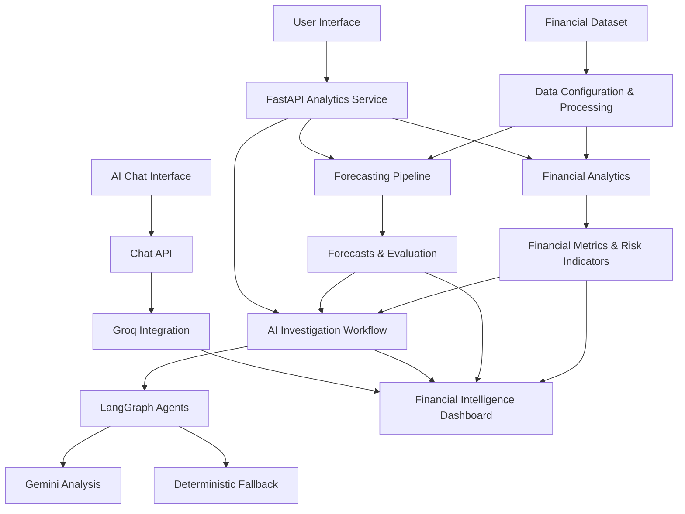

# LedgerLens AI

### Financial Intelligence · Working Capital Analytics · AI-Powered Investigation

LedgerLens AI is a financial intelligence platform designed to help businesses understand their financial position, identify emerging risks, explore future scenarios, and investigate the underlying drivers of their financial performance.

Combining financial analytics, forecasting models, heuristic risk indicators, and AI-powered investigation workflows, LedgerLens transforms financial data into insights that can support better operational and financial decisions.

---

## Overview

Financial data often tells businesses **what happened** without explaining **why it happened, what could happen next, or what they should investigate**.

LedgerLens AI aims to bridge this gap by bringing financial analytics, forecasting, risk identification, and AI-assisted investigation into a unified intelligence workspace.

Rather than relying solely on static financial dashboards, LedgerLens combines quantitative analysis with AI-driven investigation to help users explore financial trends, understand potential risks, and identify areas that require attention.

The project currently operates on synthetic financial data and serves as an experimental financial intelligence system.

---

## Core Capabilities

### 📊 Financial Intelligence Dashboard

Explore financial performance across multiple business entities through an integrated dashboard.

- Revenue and financial performance indicators
- Historical financial trends
- Entity-level financial analysis
- Financial metrics and visualizations
- Interactive analytical views

### 📈 Financial Forecasting

Explore future financial trajectories using forecasting models.

The forecasting foundation includes:

- Holt-Winters forecasting
- Moving-average baseline models
- Model selection infrastructure
- Forecast evaluation
- Prediction intervals
- Forecast uncertainty analysis

The objective is not simply to generate a future number, but to make forecasts measurable and evaluate their reliability.

### 🛡️ Financial Risk Intelligence

LedgerLens incorporates heuristic financial risk indicators to help surface potential issues that warrant further investigation.

The system brings financial metrics, historical trends, risk indicators, and investigation outputs together to provide a broader view of financial health.

Risk indicators are heuristic signals—not calibrated probabilities of financial failure.

### 🤖 AI-Powered Financial Investigation

LedgerLens integrates AI-driven analysis into its financial intelligence workflow.

The system combines financial context, quantitative outputs, and AI reasoning to investigate patterns and provide structured analysis.

Depending on configuration, AI analysis can use Gemini, while deterministic fallback behavior is available when AI credentials are unavailable.

### 💬 AI Financial Assistant

An optional Groq-backed chat service provides an additional interface for interacting with financial information.

The assistant is intended to make financial analysis more accessible through natural-language interaction.

### 🔍 Multi-Agent Analysis

LedgerLens includes a LangGraph-based agent workflow designed to support financial investigation and analysis.

The workflow connects AI reasoning with financial context and analytical outputs, enabling the system to investigate financial questions through a structured workflow rather than relying exclusively on standalone text generation.

### ⚙️ Investigation and Action Infrastructure

The project includes action-related modules for handling investigation and action workflows.

- Action engine
- Action storage
- Investigation-related processing

These components form part of the project's foundation for connecting financial insights with structured follow-up workflows.

---

## System Architecture

LedgerLens AI combines a frontend dashboard, analytics API, forecasting pipeline, AI investigation workflow, and optional AI chat service.



### Architecture Components

| Component | Responsibility |
|---|---|
| Frontend | Dashboard, financial visualization, user interactions |
| Main FastAPI service | Analytics, forecasts, dataset handling, action-related functionality and investigation APIs |
| Forecasting pipeline | Forecast generation and integration with the financial workflow |
| Model registry | Model-selection configuration and associated model metadata |
| Evaluation module | Forecast performance measurement |
| Prediction intervals | Forecast uncertainty representation |
| LangGraph workflow | AI-driven investigation orchestration |
| Gemini integration | Optional AI analysis |
| Deterministic fallback | Analysis fallback when AI credentials are unavailable |
| Groq chat service | Optional conversational AI interface |
| Action engine | Action-related processing |
| Action store | Action-related persistence/storage functionality |

---

## Forecasting & Evaluation

LedgerLens includes a forecasting foundation designed to evaluate model performance rather than rely on predictions without measurement.

### Forecasting Models

- Holt-Winters
- Moving-average baseline

### Evaluation Metrics

The evaluation framework includes:

| Metric | Purpose |
|---|---|
| MAE | Measures average absolute forecasting error |
| RMSE | Penalizes larger forecasting errors |
| MAPE | Measures percentage forecasting error |
| sMAPE | Symmetric percentage-based error measurement |
| Forecast Bias | Identifies systematic overprediction or underprediction |

### Forecast Uncertainty

LedgerLens also includes prediction interval functionality and empirical coverage evaluation.

This allows forecast outputs to be explored alongside uncertainty rather than treating every prediction as a certain outcome.

---

## AI Integration

LedgerLens uses a hybrid approach combining quantitative processing with AI analysis.

### Gemini

Gemini is used for optional AI-powered financial analysis.

Configuration:

```env
GEMINI_API_KEY=your_gemini_api_key
GEMINI_MODEL=gemini-2.5-flash
LLM_TEMPERATURE=0.2
```

When the Gemini API key is unavailable, the investigation workflow can fall back to deterministic analysis.

### Groq

Groq powers the optional AI chat service.

Configuration:

```env
GROQ_API_KEY=your_groq_api_key
```

The chat service is optional and operates separately from the main analytics API.

### AI Design Principles

- Financial calculations should remain grounded in data.
- AI should explain and interpret analytical results, not invent financial facts.
- Deterministic fallback behavior should be available where implemented.
- AI provider failures should not be confused with financial analysis results.
- API credentials should remain outside source code.

---

## Technology Stack

| Layer | Technology |
|---|---|
| Backend | Python |
| API Framework | FastAPI |
| Agent Orchestration | LangGraph |
| AI Analysis | Gemini |
| AI Chat | Groq |
| Data Processing | Pandas, NumPy |
| Forecasting | Statsmodels |
| Model Persistence | Joblib |
| Frontend | HTML, CSS, JavaScript |
| Visualization | Chart.js |
| API Server | Uvicorn |

---

## Project Structure

```text
LedgerLens-AI/
│
├── backend/
│   ├── agents/
│   │   └── LangGraph investigation workflow
│   └── api/
│       └── Optional AI chat service
│
├── frontend/
│   └── Dashboard frontend
│
├── experiments/
│   └── Forecasting model selection and experiments
│
├── action_engine.py
├── action_store.py
├── evaluation.py
├── forecasting.py
├── forecasting_schema.py
├── intervals.py
├── ledgerlens_pipeline.py
├── main.py
├── model_registry.py
│
├── test_groq.py
├── requirements.txt
├── .env.example
└── .gitignore
```

---

## Getting Started

### Prerequisites

- Python 3.10+
- pip
- Git

### 1. Clone the repository

```bash
git clone https://github.com/ADITYA1488/LedgerLens-AI.git
cd LedgerLens-AI
```

### 2. Install dependencies

```bash
python -m pip install -r requirements.txt
```

### 3. Configure environment variables

Create a `.env` file in the project root using `.env.example` as the template.

Example configuration:

```env
LEDGERLENS_DATA_DIR=data/dataset

LEDGERLENS_SELECTION_FILE=experiments/selected_forecasting_models.csv

LEDGERLENS_PROJECT_ROOT=.

GEMINI_API_KEY=
GEMINI_MODEL=gemini-2.5-flash

LLM_TEMPERATURE=0.2

GROQ_API_KEY=
```

Populate only the credentials needed for the services you intend to use.

**Never commit your actual `.env` file or API keys.**

### 4. Configure the financial dataset

LedgerLens currently uses the synthetic DD-WCP-003 financial dataset.

Place the dataset file:

```text
DD-WCP-003_FactMonthlyPL.csv
```

Inside:

```text
data/dataset/
```

Alternatively, configure `LEDGERLENS_DATA_DIR` to point to the directory containing the dataset.

The dataset used in the current experiments contains synthetic USD-denominated financial data. It should not be interpreted as real Indian MSME financial records.

---

## Running LedgerLens AI

LedgerLens uses separate services for its dashboard, analytics API, and optional chat API.

Run each service from the project root in a separate terminal.

### Terminal 1 — Main analytics API

```bash
python -m uvicorn main:app --reload --host 127.0.0.1 --port 8000
```

### Terminal 2 — Optional AI chat API

```bash
python -m uvicorn backend.api.main:app --reload --host 127.0.0.1 --port 8001
```

### Terminal 3 — Frontend

```bash
python -m http.server 5500 --directory frontend
```

Open the dashboard:

```text
http://127.0.0.1:5500
```

### Service endpoints

| Service | URL |
|---|---|
| Frontend Dashboard | http://127.0.0.1:5500 |
| Analytics API | http://127.0.0.1:8000 |
| Analytics Health | http://127.0.0.1:8000/health |
| Analytics API Documentation | http://127.0.0.1:8000/docs |
| Chat API | http://127.0.0.1:8001 |
| Chat Health | http://127.0.0.1:8001/health |

---

## Environment Configuration

| Variable | Description | Default |
|---|---|---|
| `LEDGERLENS_DATA_DIR` | Financial dataset directory | `data/dataset` |
| `LEDGERLENS_SELECTION_FILE` | Forecast model-selection file | `experiments/selected_forecasting_models.csv` |
| `LEDGERLENS_PROJECT_ROOT` | Optional project root override | Project root |
| `GEMINI_API_KEY` | Enables Gemini-backed analysis | Optional |
| `GEMINI_MODEL` | Gemini model selection | `gemini-2.5-flash` |
| `LLM_TEMPERATURE` | LLM temperature configuration | `0.2` |
| `GROQ_API_KEY` | Enables Groq-backed chat | Required for chat |

---

## 60-Second Demo Walkthrough

A quick walkthrough of the current system:

**00–10 seconds — Financial Overview**

Introduce the financial intelligence dashboard and the selected business entity. Highlight the key metrics and synthetic-data indicator.

**10–25 seconds — Financial Trends**

Explore historical trends and forecasting visualizations. Switch entities or metrics to demonstrate how the financial picture changes.

**25–40 seconds — AI Investigation**

Run the financial investigation workflow and show the analysis generated using financial context and analytical outputs.

**40–60 seconds — Risk & Intelligence**

Explore risk indicators, recommended investigation steps, and the agent execution trace.

---

## Current Experiment

The initial forecasting experiments use the synthetic DD-WCP-003 working-capital dataset from Findi360.

### Revenue Forecasting Experiment

| Parameter | Configuration |
|---|---|
| Dataset | Synthetic DD-WCP-003 |
| Training period | January 2023 – November 2025 |
| Validation period | December 2025 – September 2026 |
| Evaluation strategy | Expanding-window, one-step-ahead |

### Preliminary Results

| Model | MAPE |
|---|---:|
| Holt-Winters | 3.20% |
| Moving Average Baseline | 7.11% |

Holt-Winters achieved a lower MAPE than the moving-average baseline in this preliminary experiment.

These results apply to the synthetic dataset and experimental configuration only. They are not evidence of forecasting performance on real businesses.

---

## Data & Limitations

LedgerLens AI is an experimental financial intelligence project.

### Current Limitations

- The current experiments use synthetic financial data.
- Forecasting performance has not been established on a representative population of real businesses.
- Risk scores are heuristic indicators, not statistically calibrated probabilities.
- Forecasts depend on available historical data and assumptions.
- AI-generated analysis may contain errors and requires independent verification.
- The system is not a certified accounting, auditing, or financial advisory platform.
- External AI providers may require internet connectivity and valid API credentials.

### Data Privacy

Do not upload confidential financial data, personally identifiable information, or sensitive business records to external AI services without appropriate authorization and safeguards.

API keys must be stored in environment variables and must never be committed to the repository.

---

## Roadmap

Potential areas of future development:

- Advanced cash-flow and working-capital intelligence
- Multi-entity forecasting improvements
- Financial scenario simulation
- Deeper investigation workflows
- Evidence-grounded AI reasoning
- Expanded risk detection
- More financial data ingestion options
- Improved forecasting uncertainty evaluation
- Additional action and decision-support capabilities
- Integration with external financial systems

Roadmap items are future possibilities and are not necessarily implemented in the current version.

---

## What LedgerLens Demonstrates

- Financial data analytics
- Time-series forecasting
- Model evaluation and comparison
- Prediction interval analysis
- AI-assisted investigation
- Multi-agent workflow orchestration
- API development with FastAPI
- AI integration with Gemini and Groq
- Data processing with Pandas and NumPy
- Frontend data visualization
- Hybrid deterministic and AI-based analysis

---

## Disclaimer

LedgerLens AI is an experimental financial intelligence project built for demonstration and research purposes.

The application uses synthetic data in its current experiments. Forecasts, heuristic indicators, and AI-generated insights should not be interpreted as guaranteed financial predictions or professional financial advice.

Users should independently verify all outputs before making financial, operational, or business decisions.

---

<p align="center">
  <strong>LedgerLens AI</strong><br/>
  Turning financial data into intelligence, investigation, and decisions.
</p>
